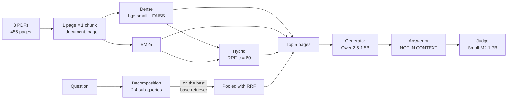
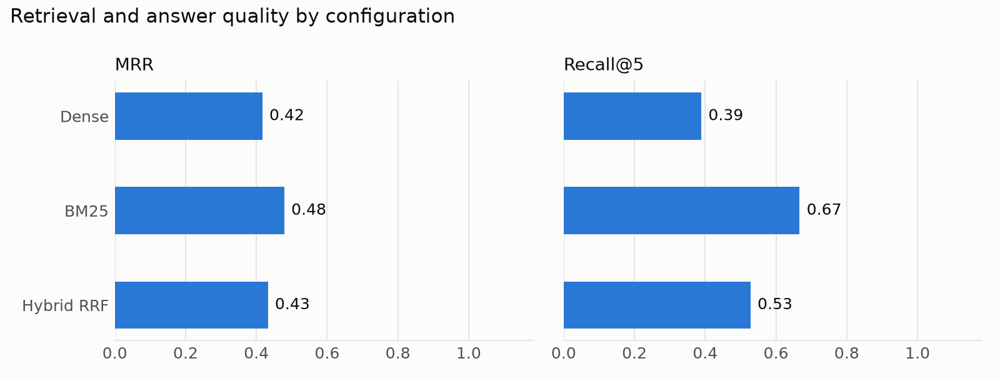

# RAG over 10-K filings: dense vs BM25 vs hybrid vs query decomposition

[](https://github.com/devpatram/sec-10k-rag-benchmark/actions/workflows/ci.yml)


How well does a small, fully open retrieval-augmented generation (RAG) pipeline answer questions about long
financial filings, and where does it fail? This repo measures four retrieval setups on three public annual reports
(NVIDIA, AMD and Intel 10-Ks, 455 pages) with 20 questions, then traces each wrong answer to the stage that broke:
retrieval or generation.

Everything runs on open models: a 33M-parameter embedder, a 1.5B generator and a 1.7B judge from a different model
family. The full run fits on a free Colab T4 GPU; the retrieval part runs on a laptop CPU in about a minute.

## Pipeline



| Role | Model | Parameters | Notes |
| --- | --- | --- | --- |
| Embedder | `BAAI/bge-small-en-v1.5` | 33M | 384 dimensions, 512-token input |
| Generator | `Qwen/Qwen2.5-1.5B-Instruct` | 1.5B | greedy decoding |
| Judge | `HuggingFaceTB/SmolLM2-1.7B-Instruct` | 1.7B | a different family from the generator, so it is not grading its own style |

## Results

### Retrieval (CPU run, all 18 answerable questions)

| Retriever | MRR | Recall@5 |
| --- | --- | --- |
| Dense | 0.417 | 0.389 |
| BM25 | **0.479** | **0.667** |
| Hybrid RRF | 0.432 | 0.528 |



**BM25 wins on these questions, and hybrid fusion does not beat it.** Two reasons, both visible in the per-question
output (`results/retrieval_only/answers.jsonl`):

- **The embedder sees only part of most pages.** bge-small reads 512 tokens. The median 10-K page here is 636 tokens
  and 56% of pages are longer than 512, so the dense index never sees the bottom of most pages, which is often where
  the figure is.
- **The questions use the filings' own words** ("employees", "repurchased", "net revenue"), which BM25 matches
  exactly. Dense retrieval pulls the summary tables near the top of the financial section, which look alike across
  pages and across companies.

Fusion finds a page that neither retriever ranks in its own top 5 on three questions (6, 10 and 14). But where only
BM25 has the page (NVIDIA's and AMD's headcounts, NVIDIA's buyback and gross margin: questions 4, 5, 7 and 9), dense's
ranking pushes it out of the top 5. Dense alone wins one question, the cash comparison (17), and nothing finds
Intel's customer concentration (13). The three-company comparisons are the hardest for every retriever: no
retriever covers more than two of the three companies in five pages.

### Answer quality (GPU run)

<!-- RESULTS:FULL -->

## Design choices

| Choice | Why |
| --- | --- |
| One page per chunk, labeled with document and page | Every answer can be traced to a page someone can open. Fixed-size token windows split tables. |
| Evidence is a text anchor, not a page number | A figure such as `215,938` is often printed on several pages (the summary, the income statement, the segment note). Recall counts a **fact** as found when any page carrying it is retrieved, so a repeated figure does not halve recall, and the metric survives a different PDF rendering. |
| Comparison questions need every company | Recall@5 for "rank the three by revenue" is the share of the three companies' figures retrieved, so 1 of 3 scores 0.33. |
| Abstention is scored in code | `NOT IN CONTEXT` on an unanswerable question scores 5; on an answerable one it scores 1 and counts as a refused question. In the first version of this project a 1.7B judge graded correct refusals as 2 out of 5, which made the pipeline look worse for doing the right thing. |
| The judge is another model family | A model grading its own family's wording tends to be generous. |
| Decomposition goes on the best base retriever by a stated rule | Highest correctness, then Recall@5, so the choice is not made after looking at decomposition's results. |
| Greedy decoding, fixed models, page text capped per call | The same inputs give the same answers, and the judge's prompt fits its context window. |

## Run it

```bash
git clone https://github.com/devpatram/sec-10k-rag-benchmark.git
cd sec-10k-rag-benchmark
pip install -r requirements.txt
# put the three PDFs in data/pdfs (see data/README.md), then:
python -m ragbench.run --retrieval-only      # CPU, about a minute
python -m ragbench.run                       # GPU; or open notebooks/run_on_colab.ipynb in Colab
```

Options: `--k`, `--generator`, `--judge` (any Hugging Face chat model), `--limit N` for a quick smoke test.
Outputs go to `results/`: `summary.md`, `summary.csv`, `by_difficulty.csv`, `answers.jsonl` (every question,
configuration, retrieved page, answer and score) and `comparison.png`.

## Tests

`pytest -q` runs in CI on Python 3.11 and 3.12 without models or PDFs: the metrics (a repeated fact counts once,
comparisons need every company), Reciprocal Rank Fusion, query-decomposition pooling, page chunking on a generated
PDF, anchors that survive line breaks and do not match inside a bigger number, and the shape of the question set.
With the PDFs present, one more test checks that every anchor lands on a page.

## Limits

- 20 questions is a small set: one question moves a mean by 0.05. Read the per-question file, not just the means.
- The judge is a 1.7B model. Its scores are a rough signal; the retrieval metrics are exact.
- Page text is capped (2,500 characters for the generator, 1,200 for the judge), so a figure at the very bottom of
  a long page can be cut.

## Where it came from

This started as my homework for SEAS 8520 (Deep Learning and Natural Language Processing) at George Washington
University in summer 2026. This repo is a standalone rebuild of my own solution: a new question set and new prompts
written for it, evidence located by text anchors, abstention scored in code, and tests.

## License

Code: MIT, see [LICENSE](LICENSE). The filings are public documents from SEC EDGAR and are not included.
